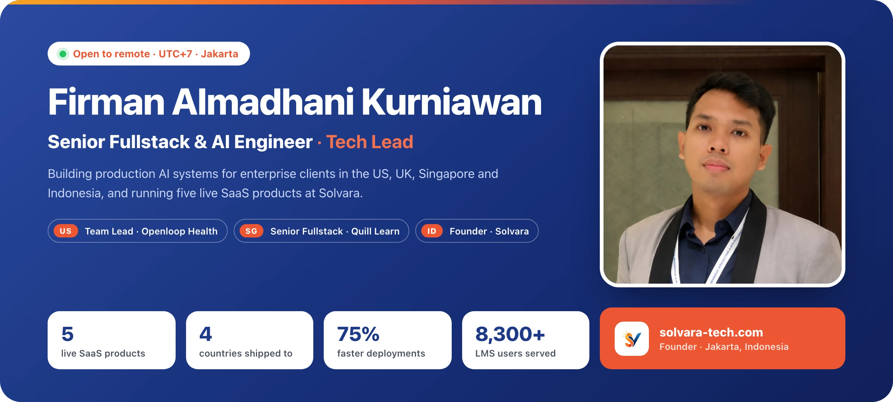
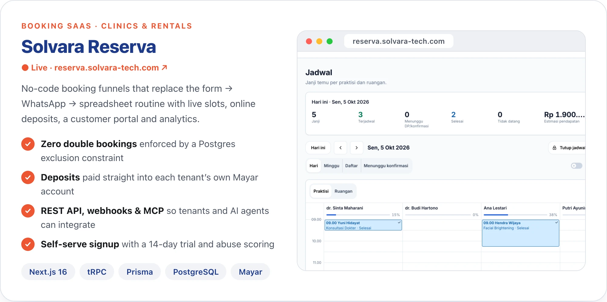
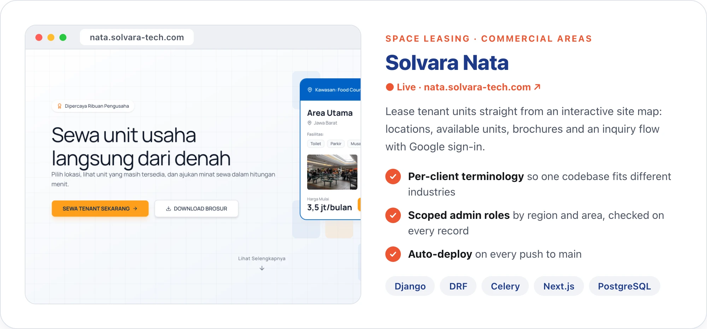
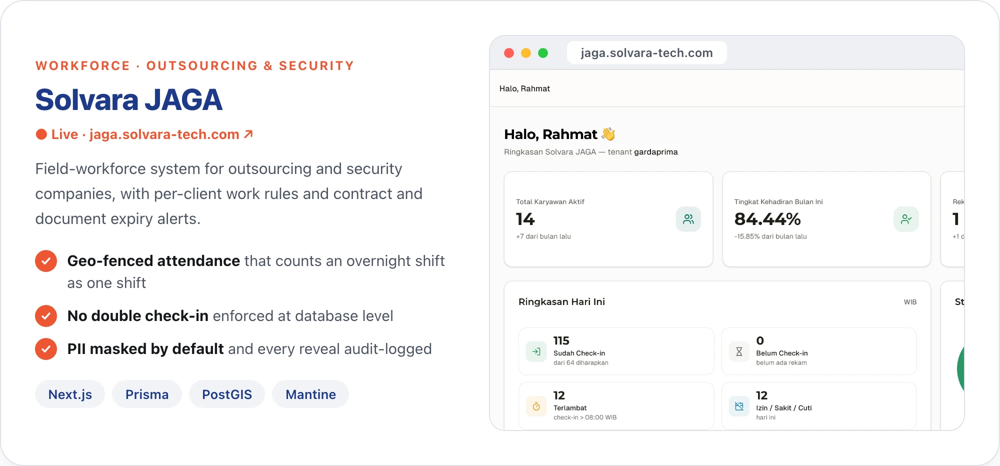
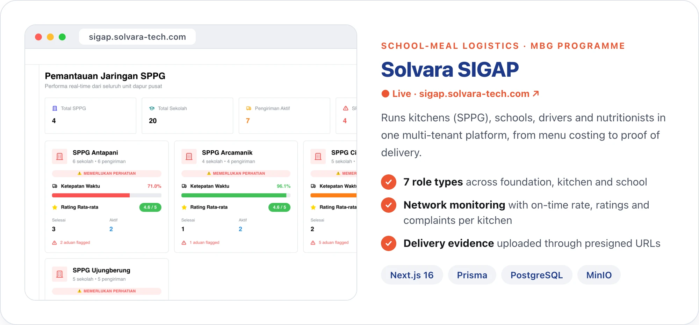
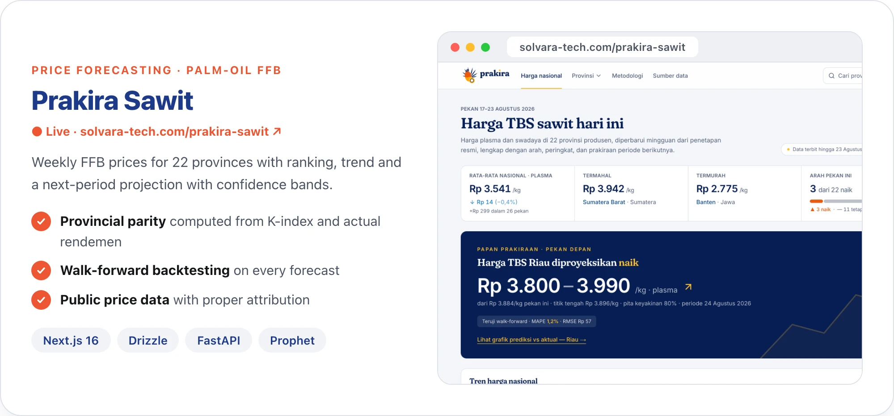
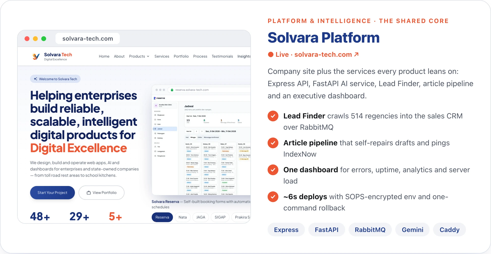
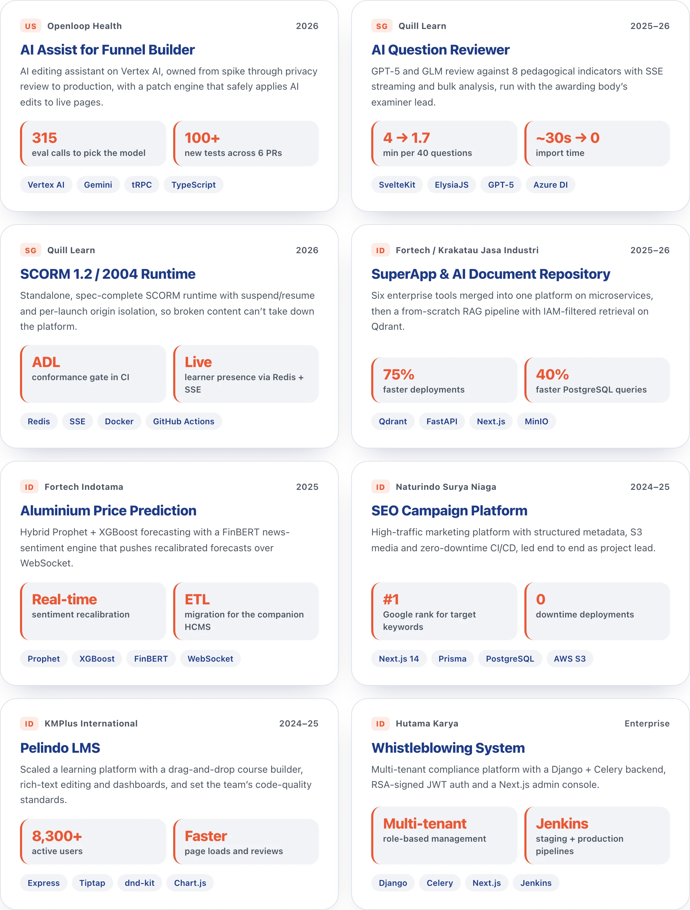
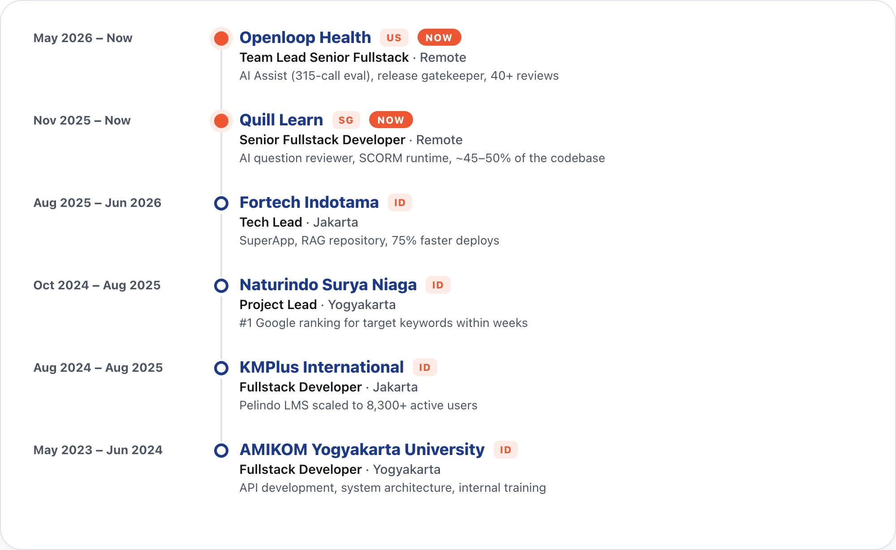
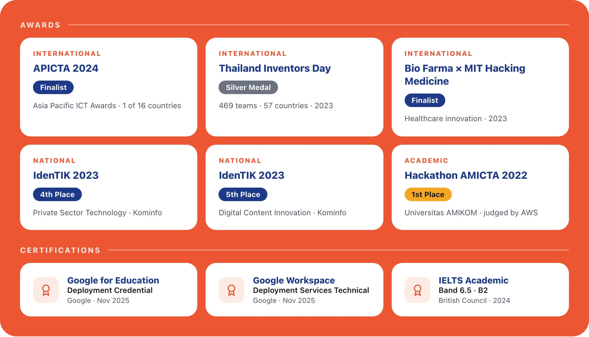

<!-- Visual assets are rendered from ../almadhanif-readme-kit (node build.cjs && node make-readme.cjs) -->

  

  
  
  
   
  
  
  

<picture>
  <source media="(prefers-color-scheme: dark)" srcset="assets/readme/sec-about-dark.webp">
  
</picture>

Tech Lead and Senior Fullstack Engineer building production AI systems for enterprise clients in the US, UK, Singapore, and Indonesia. I own features from technical spike through privacy review, build, and post-deploy validation, most recently an AI editing assistant on Vertex AI selected through a 315-call evaluation harness.
- Team Lead Senior Fullstack Developer at **Openloop Health** (US telehealth) and Senior Fullstack Developer at **Quill Learn** (Singapore), based in Jakarta (UTC+7)
- Strengths: RAG pipelines and LLM integration, microservice architecture, and making systems fast under real load: `75%` faster deployments, `40%` faster queries, 4-minute analyses cut to under 2
- Release gatekeeper for my teams; comfortable working across US and European time zones in English
- Founder-builder of **[Solvara](https://solvara-tech.com)**: five live SaaS products covering booking and online deposits, commercial space leasing, workforce management, school nutrition logistics, and commodity price forecasting, plus the in-house sales, AI and ops tooling that runs them on a single VPS
- APICTA 2024 Finalist and Silver Medal recipient at Thailand Inventors Day 2023

<picture>
  <source media="(prefers-color-scheme: dark)" srcset="assets/readme/sec-products-dark.webp">
  
</picture>

<a href="https://reserva.solvara-tech.com">
<picture>
  <source media="(prefers-color-scheme: dark)" srcset="assets/readme/product-reserva-dark.webp">
  
</picture>
</a>
  
<a href="https://nata.solvara-tech.com">
<picture>
  <source media="(prefers-color-scheme: dark)" srcset="assets/readme/product-nata-dark.webp">
  
</picture>
</a>
  
<a href="https://jaga.solvara-tech.com">
<picture>
  <source media="(prefers-color-scheme: dark)" srcset="assets/readme/product-jaga-dark.webp">
  
</picture>
</a>
  
<a href="https://sigap.solvara-tech.com">
<picture>
  <source media="(prefers-color-scheme: dark)" srcset="assets/readme/product-sigap-dark.webp">
  
</picture>
</a>
  
<a href="https://solvara-tech.com/prakira-sawit">
<picture>
  <source media="(prefers-color-scheme: dark)" srcset="assets/readme/product-prakira-dark.webp">
  
</picture>
</a>
  
<a href="https://solvara-tech.com">
<picture>
  <source media="(prefers-color-scheme: dark)" srcset="assets/readme/product-platform-dark.webp">
  
</picture>
</a>

Live links:
<a href="https://reserva.solvara-tech.com">Reserva</a> ·
<a href="https://nata.solvara-tech.com">Nata</a> ·
<a href="https://jaga.solvara-tech.com">JAGA</a> ·
<a href="https://sigap.solvara-tech.com">SIGAP</a> ·
<a href="https://solvara-tech.com/prakira-sawit">Prakira Sawit</a> ·
<a href="https://solvara-tech.com">solvara-tech.com</a>
· all running on one 4 vCPU / 8 GB VPS behind Caddy

<picture>
  <source media="(prefers-color-scheme: dark)" srcset="assets/readme/sec-client-dark.webp">
  
</picture>

<picture>
  <source media="(prefers-color-scheme: dark)" srcset="assets/readme/client-work-dark.webp">
  
</picture>

SEO platform live at <a href="https://umrohnaturindo.com">umrohnaturindo.com</a>

<picture>
  <source media="(prefers-color-scheme: dark)" srcset="assets/readme/sec-timeline-dark.webp">
  
</picture>

<picture>
  <source media="(prefers-color-scheme: dark)" srcset="assets/readme/timeline-dark.webp">
  
</picture>

<picture>
  <source media="(prefers-color-scheme: dark)" srcset="assets/readme/sec-stack-dark.webp">
  
</picture>

<picture>
  <source media="(prefers-color-scheme: dark)" srcset="assets/readme/stack-dark.webp">
  
</picture>

<picture>
  <source media="(prefers-color-scheme: dark)" srcset="assets/readme/sec-awards-dark.webp">
  
</picture>

<picture>
  <source media="(prefers-color-scheme: dark)" srcset="assets/readme/sec-stats-dark.webp">
  
</picture>

<picture>
  <source media="(prefers-color-scheme: dark)" srcset="https://streak-stats.demolab.com/?user=almadhanif&hide_border=true&border_radius=24&background=111A33&ring=F4714F&fire=F4714F&currStreakLabel=FFFFFF&sideLabels=FFFFFF&currStreakNum=FFFFFF&sideNums=FFFFFF&dates=A3AEC4&stroke=24325C">
  
</picture>

  

 

  

